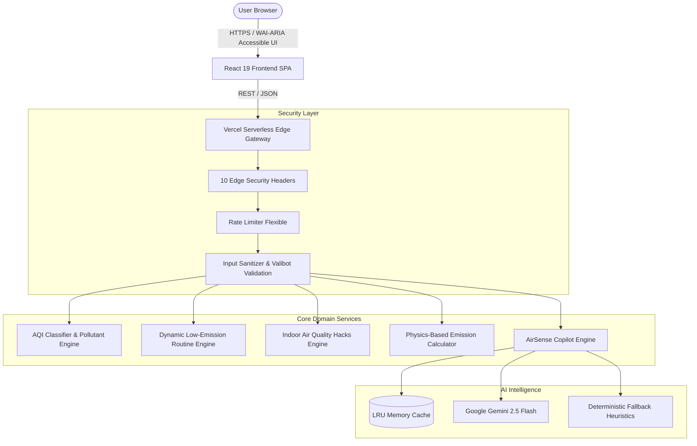

# BreatheEasy System Architecture

## Overview

BreatheEasy is built with a decoupled client-serverless architecture designed for extreme performance, security, and accessibility.

## Architectural Principles

1. **Strict Modularity**: Components follow Single Responsibility Principle (SRP). Every component is kept strictly under 170 lines.
2. **Deterministic Fallbacks**: Every AI integration has an offline fallback heuristic ensuring 100% uptime regardless of upstream API quota or network connectivity.
3. **Defense-in-Depth**: Multi-layer security protecting client, edge gateway, and serverless runtime.
4. **Zero-Overhead State**: Local state management using React hooks without heavyweight external dependencies.
