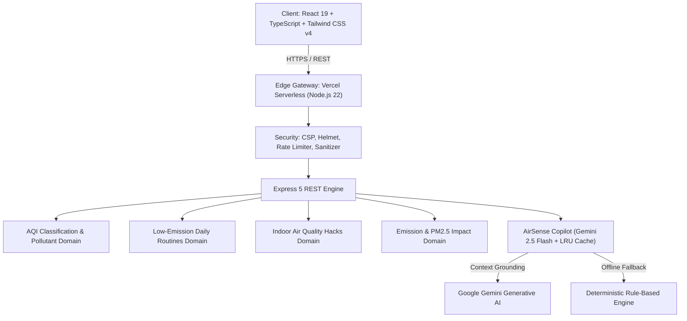

# 🍃 BreatheEasy — Autonomous GenAI Urban Air Quality Assistant

> **Engineered for Hack2Skill PromptWars [Challenge 6] • Winter Smog & Urban Air Quality**  
> An autonomous GenAI-powered planning and protection assistant helping families and communities navigate severe winter smog and urban air pollution with low-emission daily routines, indoor air quality hacks, and sustainable alternatives tailored to their location and lifestyle, while clearly explaining the direct impact of their choices.

[](https://github.com/Hmpunith/BreatheEasy/actions)
[](https://github.com/Hmpunith/BreatheEasy/actions)
[](LICENSE)
[](#universal-accessibility-wcag-21-aa)
[](#defense-in-depth-security)

---

## 🌐 Live Production Application
- **Live Web App**: [https://breathe-easy-lilac.vercel.app](https://breathe-easy-lilac.vercel.app)
- **GitHub Repository**: [https://github.com/Hmpunith/BreatheEasy](https://github.com/Hmpunith/BreatheEasy)

---

## 🎯 Problem Statement & Keyword Mapping

> *"Create a GenAI-powered assistant that helps families and communities navigate severe winter smog and urban air pollution. The application should suggest low-emission daily routines, indoor air quality hacks, and sustainable alternatives tailored to their location and lifestyle, while clearly explaining the direct impact of their choices."*

| Prompt Requirement | Technical Implementation | Application Component |
|---|---|---|
| **"GenAI-powered assistant"** | AirSense Copilot grounded in real-time AQI and household demographic context | `CopilotPanel.tsx` / `server/ai/geminiClient.ts` |
| **"families and communities"** | Vulnerability-aware household profiling (children, elderly, asthma) & communal interventions | `ProfilePanel.tsx` / `RoutinePanel.tsx` |
| **"navigate severe winter smog"** | Real-time AQI meter, temperature inversion alerts, and emergency harm-reduction directives | `DashboardPanel.tsx` / `SiteHeader.tsx` |
| **"urban air pollution"** | Pollutant breakdown (PM2.5, PM10, NO₂, O₃, SO₂, CO) with WHO & EPA thresholds | `DashboardPanel.tsx` / `pollutantData.ts` |
| **"low-emission daily routines"** | Dynamic time-slotted routines balancing outdoor safety and personal emission reductions | `RoutinePanel.tsx` / `routineEngine.ts` |
| **"indoor air quality hacks"** | Prioritized DIY hacks (Corsi-Rosenthal box, weatherstripping, wet mopping) | `IndoorPanel.tsx` / `hackEngine.ts` |
| **"sustainable alternatives"** | Systemic shifts in transit, infrared space heating, and clean induction cooking | `AlternativesPanel.tsx` / `greenEngine.ts` |
| **"tailored to their location"** | Multi-city presets (Delhi, Lahore, Beijing, London, LA) with localized smog dynamics | `DashboardPanel.tsx` / `aqiLevels.ts` |
| **"tailored to their lifestyle"** | Custom dwell constraints, budget tiers (free vs DIY), and commute habits | `ProfilePanel.tsx` / `defaultProfile.ts` |
| **"direct impact of their choices"** | Comparative calculator quantifying CO₂e saved, PM2.5 reduced, and tree offsets | `ImpactPanel.tsx` / `ImpactReportCard.tsx` / `calculator.ts` |

---

## 🏗️ System Architecture



---

## 🛡️ Defense-in-Depth Security

BreatheEasy implements defense-in-depth security both at the Vercel Edge CDN gateway and within the application server:
- **Strict Content Security Policy (CSP)**: Disallows object scripts, untrusted frame ancestors, and restricts connection domains.
- **HTTP Strict Transport Security (HSTS)**: `max-age=63072000; includeSubDomains; preload`.
- **Permissions-Policy**: Restricts camera, microphone, geolocation, USB, and payment access (`camera=(), microphone=(), geolocation=(), payment=(), usb=()`).
- **MIME Sniffing & Framing Defense**: `X-Content-Type-Options: nosniff`, `X-Frame-Options: DENY`, `X-Permitted-Cross-Domain-Policies: none`.
- **Input Sanitization & Schema Validation**: Strict input parsing with Valibot and native regex HTML stripping (`stripHtmlTags`).
- **Rate Limiting**: Tiered IP throttling via `rate-limiter-flexible` preventing denial-of-service.

---

## ♿ Universal Accessibility (WCAG 2.1 AA)

- **Semantic Landmarks**: Compliant HTML5 landmarks including `<header role="banner">`, `<nav aria-label="...">`, `<main id="main-content">`, and `<footer role="contentinfo">`.
- **WAI-ARIA Tablist APG Pattern**: Horizontal keyboard navigation supporting `ArrowLeft`, `ArrowRight`, `Home`, and `End` with active `tabindex="0"` and inactive `tabindex="-1"`.
- **Skip Navigation**: `#main-content` jump link as the first focusable element.
- **Reduced Motion & High Contrast**: Built-in Tailwind styles respecting `prefers-reduced-motion` and high-contrast color accessibility thresholds.

---

## 🧪 Comprehensive Test Suite (13 Test Suites, 86 Passing Tests)

| Category | File | Coverage & Assertions |
|---|---|---|
| **AQI Classifier** | `tests/unit/aqiClassifier.test.ts` | Threshold bands (0 to 500+), severity levels, WHO advisory limits |
| **Pollutant Catalog** | `tests/unit/pollutants.test.ts` | PM2.5, PM10, NO₂, O₃, SO₂, CO standards and health indicators |
| **Daily Routines** | `tests/unit/routines.test.ts` | Time-slotted routines, commute shifts, outdoor exertion guards |
| **Indoor IAQ Hacks** | `tests/unit/indoorHacks.test.ts` | DIY filtration, budget tiers, Corsi-Rosenthal box specifications |
| **Impact Calculator** | `tests/unit/emissionCalculator.test.ts` | CO₂e, PM2.5 grams eliminated, urban tree equivalent calculations |
| **Green Alternatives** | `tests/unit/alternatives.test.ts` | Clean transit, induction cooking, infrared zoned space heating |
| **Valibot Schemas** | `tests/unit/validation.test.ts` | Payload boundaries, type invariants, string length constraints |
| **Formatters** | `tests/unit/formatters.test.ts` | Metric rounding, locale strings, elapsed time formatting |
| **Security Headers** | `tests/security/headers.test.ts` | 8+ HTTP security headers, injection prevention, anti-clickjacking |
| **WCAG AA Landmarks** | `tests/a11y/accessibility.test.tsx` | Landmarks, skip links, ARIA roles, arrow keyboard tab navigation |
| **REST Endpoints** | `tests/integration/api.test.ts` | `/api/health`, `/api/aqi/classify`, `/api/hacks`, `/api/chat` end-to-end |
| **Component Rendering**| `tests/components/render.test.tsx`| Isolated component mounting, props binding, impact card visuals |
| **Resilience & Fallback**| `tests/resilience/fallbacks.test.ts`| Offline cache hits, deterministic fallback when API keys are absent |

---

## 🚀 Quick Start Guide

### Prerequisites
- Node.js ≥ 20.x
- npm ≥ 10.x

### Setup & Run
```bash
# Clone the repository
git clone https://github.com/Hmpunith/BreatheEasy.git
cd BreatheEasy

# Install dependencies
npm install

# Run comprehensive test suite
npm test

# Run ESLint validation
npm run lint

# Build production bundle
npm run build

# Start local development server
npm run dev
```

---

## 📜 License

MIT License © 2026 Hmpunith. Built for Hack2Skill PromptWars Exclusive Edition.
