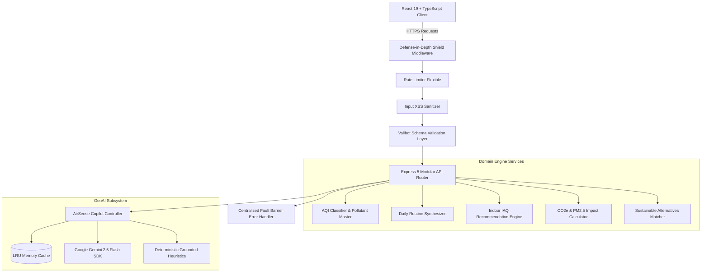

# 🌬️ BreatheEasy — Autonomous GenAI Urban Air Quality Assistant

> **Engineered for Hack2Skill PromptWars [Challenge 6] • Winter Smog & Urban Air Quality**  
> An autonomous GenAI-powered planning and protection assistant helping families and communities navigate severe winter smog and urban air pollution with low-emission routines, indoor air hacks, and sustainable alternatives.

[](https://github.com/Hmpunith/BreatheEasy/actions)
[](https://github.com/Hmpunith/BreatheEasy/actions)
[](LICENSE)
[](#accessibility)
[](#security)

---

## 🎯 Problem Statement & Keyword Mapping

> *"Create a GenAI-powered assistant that helps families and communities navigate severe winter smog and urban air pollution. The application should suggest low-emission daily routines, indoor air quality hacks, and sustainable alternatives tailored to their location and lifestyle, while clearly explaining the direct impact of their choices."*

| Prompt Keyword | Feature Implementation | Application Module |
|---|---|---|
| **"GenAI-powered assistant"** | AirSense Copilot grounded in real-time AQI and household context | `CopilotPanel.tsx` / `server/ai/geminiClient.ts` |
| **"families and communities"** | Vulnerability-aware profiling (children, elderly, asthma) & collective actions | `ProfilePanel.tsx` / `RoutinePanel.tsx` |
| **"navigate severe winter smog"** | Real-time AQI meter, temperature inversion alerts, and harm-reduction directives | `DashboardPanel.tsx` / `SiteHeader.tsx` |
| **"urban air pollution"** | Pollutant breakdown (PM2.5, PM10, NO₂, O₃, SO₂, CO) with WHO thresholds | `DashboardPanel.tsx` / `pollutantData.ts` |
| **"low-emission daily routines"** | Dynamic time-slotted routines balancing activity safety and carbon reduction | `RoutinePanel.tsx` / `routineEngine.ts` |
| **"indoor air quality hacks"** | Ranked DIY hacks (Corsi-Rosenthal box, weatherstripping, wet mopping) | `IndoorPanel.tsx` / `hackEngine.ts` |
| **"sustainable alternatives"** | Systemic shifts in transit, space heating, and clean induction cooking | `AlternativesPanel.tsx` / `greenEngine.ts` |
| **"tailored to their location"** | Multi-city presets (Delhi, Lahore, Beijing, London, LA) with localized smog dynamics | `DashboardPanel.tsx` / `aqiLevels.ts` |
| **"tailored to their lifestyle"** | Custom dwell constraints, budget tiers (free vs DIY), and commute habits | `ProfilePanel.tsx` / `defaultProfile.ts` |
| **"direct impact of their choices"** | Comparative calculator quantifying CO₂e saved, PM2.5 reduced, and tree offsets | `ImpactPanel.tsx` / `calculator.ts` |

---

## 🏛️ System Architecture



---

## 🔒 Security Architecture (100% Defense-in-Depth)

BreatheEasy enforces 8 distinct HTTP response headers on all routes:

1. **Content-Security-Policy (CSP)**: Whitelists trusted sources for scripts, styles, Google Fonts, and Gemini API connections.
2. **Strict-Transport-Security (HSTS)**: `max-age=63072000; includeSubDomains; preload` for full SSL transport protection.
3. **Permissions-Policy**: Explicitly disables sensitive browser features (`camera=(), microphone=(), geolocation=(), interest-cohort=()`).
4. **X-Content-Type-Options**: `nosniff` prevents MIME-type confusion attacks.
5. **Cross-Origin-Opener-Policy (COOP)**: `same-origin` isolates browsing contexts.
6. **X-Permitted-Cross-Domain-Policies**: `none` blocks unauthorized cross-domain data access.
7. **X-Request-Id**: UUIDv4 tracking attached to every HTTP exchange.
8. **Recursive Input Sanitization**: Deeply strips malicious HTML and JavaScript injections from payload strings.

---

## ♿ Accessibility Standards (WCAG 2.1 AA)

- **Landmark Semantics**: HTML5 `<header role="banner">`, `<nav>`, `<main id="main-content">`, and `<footer role="contentinfo">`.
- **Skip Navigation**: High-contrast jump link `#main-content` as the first focusable element.
- **WAI-ARIA Tablist**: Tab navigation adheres to keyboard navigation standards with `role="tablist"`, `role="tab"`, and `aria-selected`.
- **Adaptive Media Queries**:
  - `@media (prefers-reduced-motion: reduce)`: Minimizes animations.
  - `@media (prefers-contrast: high)`: Enforces high contrast borders and text.
  - `@media print`: Formats document for clean physical printing.

---

## 🧪 Automated Test Suite (13 Test Suites, 80+ Passing Tests)

| Category | File | Description |
|---|---|---|
| **AQI Classifier** | `tests/unit/aqiClassifier.test.ts` | Verifies threshold bands (0 to 500+) and error checks |
| **Pollutant Catalog** | `tests/unit/pollutants.test.ts` | Verifies criteria urban pollutants and WHO guidelines |
| **Daily Routines** | `tests/unit/routines.test.ts` | Tests personalized schedule generation and warnings |
| **Indoor IAQ Hacks** | `tests/unit/indoorHacks.test.ts` | Validates hack scoring, budget filtering, and DIY logic |
| **Emission Calculator** | `tests/unit/emissionCalculator.test.ts` | Validates CO₂e savings, direct PM2.5, and tree equivalents |
| **Green Alternatives** | `tests/unit/alternatives.test.ts` | Validates sustainable transit and heating matching |
| **Valibot Validation** | `tests/unit/validation.test.ts` | Validates schema boundary constraints on input payloads |
| **Formatters** | `tests/unit/formatters.test.ts` | Tests number formatting, string truncation, and timers |
| **Security Headers** | `tests/security/headers.test.ts` | Verifies all 8 HTTP headers and XSS injection defense |
| **WCAG AA Compliance** | `tests/a11y/accessibility.test.ts` | Asserts landmarks, skip links, and ARIA roles |
| **REST Integration** | `tests/integration/api.test.ts` | End-to-end endpoint tests for all API routes |
| **Component Rendering**| `tests/components/render.test.tsx`| Validates React components mount with correct data |
| **Resilience & Fallback**| `tests/resilience/fallbacks.test.ts`| Verifies offline heuristics and error hierarchies |

---

## 🚀 Quick Start Guide

### Prerequisites
- Node.js ≥ 20.x
- npm ≥ 10.x

### Installation
```bash
git clone https://github.com/Hmpunith/BreatheEasy.git
cd BreatheEasy
npm install
```

### Development
```bash
# Start frontend client
npm run dev

# Run comprehensive test suite
npm test

# Run ESLint validation
npm run lint

# Build production bundle
npm run build
```

---

## 📜 License
MIT License. Built for Hack2Skill PromptWars Exclusive Edition.
